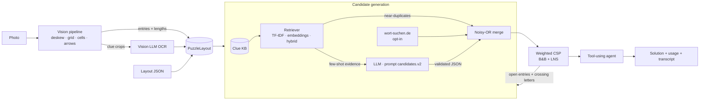

# Crossword Solver — a production-style GenAI system

[](https://github.com/alels001/crossword-solver/actions/workflows/ci.yml)


Take a photo of a German *Schwedenrätsel* and get the solved grid back.
The project started as a research notebook (computer vision + OCR + scraping + a CSP) and has been rebuilt into a
**deployable LLM application** that covers the whole GenAI lifecycle: concept, prompt engineering, retrieval,
agents, evaluation, serving, monitoring and developer tooling.


---

## What it does

| Capability | Where | Highlights |
|---|---|---|
| **Vision → structure** | `vision/` | Deskew, grid rectification, Sauvola/XDoG binarisation, clue-cell detection, arrow template matching, answer lengths |
| **Vision-LLM OCR** | `ocr.py` | Clue cells cropped and transcribed by GPT-4.1 / Claude (parallel, cached) |
| **RAG** | `knowledge/` | Clue knowledge base, char-n-gram TF-IDF (OCR-robust), dense embeddings, hybrid reciprocal-rank fusion |
| **LLM candidate generation** | `candidates/` | Versioned prompts, retrieved few-shots, crossing-letter patterns, JSON validated with pydantic + automatic repair turn |
| **Constraint solving** | `solver/csp.py` | Weighted CSP with "leave open" values, branch & bound, forward checking, large-neighbourhood search |
| **Tool-using agent** | `solver/agent.py` | LLM agent with 7 tools (`get_board`, `check_word`, `place_answer` …); every write validated in code |
| **Serving** | `serving/` | FastAPI (sync + async jobs), Streamlit chat assistant, **MCP server** for coding agents, Typer CLI, Docker |
| **LLMOps** | `llm/middleware.py`, `observability.py` | Provider abstraction (OpenAI / Anthropic / offline), response cache, token & cost tracking, per-request budget, JSON logs, `/metrics` |
| **Evaluation** | `eval/` | Benchmark with gold answers, hold-out against leakage, accuracy / cost / latency report, solver robustness study |
| **GenAI for developers** | `tools/ai_review/`, `.github/` | LLM pull-request reviewer (structured findings, posted by a GitHub Action), MCP integration, `CONTRIBUTING.md` |

## Architecture



More detail, including the agent loop and the design decisions, in [`docs/architecture.md`](docs/architecture.md).

## Quick start

```bash
git clone https://github.com/alels001/crossword-solver.git && cd crossword-solver
python -m venv .venv && source .venv/bin/activate
pip install -e ".[all,dev]"

cp .env.example .env          # set CWS_LLM_PROVIDER=openai|anthropic and the API key
crossword suggest "sizilianischer Vulkan" 5 --pattern "A___A"
crossword solve data/benchmark/puzzle_01.json
crossword solve my_photo.jpg --out report.json
```

Everything also runs **offline without a key** (`CWS_LLM_PROVIDER=fake`): the knowledge base and the solver work,
the LLM stages return nothing — useful for CI and to measure what the model adds.

### Interfaces

```bash
crossword serve          # REST API on :8000, OpenAPI docs at /docs
crossword ui             # Streamlit: chat assistant · clue helper · solve a photo
crossword mcp            # MCP server on stdio
docker compose up        # API + UI in containers
```

**REST API**

| Method | Path | Purpose |
|---|---|---|
| `POST` | `/v1/candidates` | Ranked answers for one clue (`{"clue": "...", "length": 5, "pattern": "A___A"}`) |
| `POST` | `/v1/solve/layout` | Solve a structured puzzle, optionally with known answers |
| `POST` | `/v1/jobs` · `GET /v1/jobs/{id}` | Upload a photo; solved asynchronously (vision + OCR + LLM take time) |
| `POST` | `/v1/chat` | RAG chat assistant |
| `GET` | `/healthz` · `/metrics` | Liveness and Prometheus-style metrics |

Optional `X-API-Key` auth (`CWS_API_KEY`), upload type/size limits, per-request LLM budget, request IDs in every log line.

**MCP — use the solver from any MCP client (IDE agents, desktop assistants)**

```json
{"mcpServers": {"crossword": {"command": "crossword", "args": ["mcp"]}}}
```

Tools: `suggest_answers`, `search_clue_database`, `solve_crossword`, `list_prompts`.

## Evaluation

```bash
python -m eval.run_eval      # writes eval/reports/report_<provider>.{md,json}
```

`data/benchmark/puzzle_01.json` is the puzzle from the original project photo: 26 clues, gold answers checked for
crossing consistency by a test. Before solving, every benchmark clue is **removed from the knowledge base** so
retrieval cannot leak answers.

| Setting | Entry accuracy | Letter accuracy | Precision of filled entries |
|---|---|---|---|
| Offline (no LLM), KB with hold-out | 0 % | 0 % | — (solver leaves everything open rather than guess) |
| Solver only: gold offered for ~82 % of entries among 14 distractors | 79.6 % | 89.5 % | 90.5 % |
| With OpenAI / Anthropic | run `python -m eval.run_eval` with a key — the report adds cost and latency per puzzle | | |

The solver-only study isolates the constraint stage: with random confidences that often rank distractors above the
right answer, crossing constraints still recover almost every entry whose answer is among the candidates. The
offline row is the floor that the LLM stages build on.

## Engineering notes

- **Prompts are code.** Each prompt lives in `llm/prompts/<name>.v<N>.md`; the original notebook prompt is kept as
  `candidates.v1` for comparison. Clue text is fenced and declared as data (it comes from OCR of an image), and model
  output is never trusted: length, alphabet and pattern are re-validated in code. See [`docs/prompt-engineering.md`](docs/prompt-engineering.md).
- **Solver fix.** The notebook's backtracking pruned shared candidate lists during propagation and never restored
  them, so one failed branch could delete the correct answer. The new solver keeps search state immutable per branch,
  allows entries to stay open, and adds a crossing bonus so mutually confirming words beat isolated guesses.
- **Cost control.** Response cache (SQLite), per-puzzle budget (`CWS_MAX_COST_USD_PER_PUZZLE`), token accounting in
  every response and on `/metrics`; budget exhaustion degrades to a partial solution instead of an error.
- **Tests without paid APIs.** 57 tests (90 % line coverage outside the vision module, which has its own regression tests) use fake/scripted LLMs, recorded adapter payloads and a
  synthetic rendered crossword for the vision pipeline. CI runs lint, mypy, tests, the offline eval and a Docker smoke test.

## Repository layout

```
src/crossword_solver/
  vision/        photo → grid, clue cells, arrows, entries
  llm/           provider adapters, middleware (cache, cost, budget), structured output, versioned prompts
  knowledge/     clue store, retrievers (TF-IDF, embeddings, hybrid)
  candidates/    knowledge-base, web-dictionary and LLM sources + fusion
  solver/        weighted CSP and the tool-using agent
  serving/       FastAPI, MCP server, Streamlit UI
  pipeline.py    orchestration used by every interface
  cli.py
data/            knowledge base and benchmark
eval/            evaluation harness and reports
tools/ai_review/ LLM pull-request reviewer
docs/            architecture, prompt engineering, operations, ADRs
notebooks/       the original research notebook
```

## Limitations and next steps

- The vision stage is tuned for 13 × 10 grids with the solution box bottom-right (configurable); bent arrows and two
  arrows in one cell are not detected reliably yet — a small detector trained on labelled cells is the next step.
- The knowledge base is a curated seed (~400 clues). Importing a large clue corpus would make retrieval far more useful.
- One benchmark puzzle is enough for regression tests but not for model selection; more labelled puzzles are needed.

---

<details>
<summary><b>Kurzfassung auf Deutsch</b></summary>

Ein Foto eines deutschen Schwedenrätsels wird automatisch gelöst: Computer Vision erkennt Raster, Fragefelder und
Pfeile, ein Vision-LLM liest die Fragen, ein RAG-System (Wissensdatenbank + LLM mit versionierten Prompts) erzeugt
Lösungskandidaten, ein gewichteter Constraint-Solver kombiniert sie über die Kreuzungen, und ein Agent mit Tools
füllt offene Felder. Bereitgestellt als REST-API (FastAPI), Chat-Oberfläche (Streamlit), MCP-Server für
Coding-Agents und Docker-Image — mit Kosten-Tracking, Budget-Limits, Caching, Logging, Evaluation und CI.
Für Entwickler gibt es zusätzlich einen LLM-basierten Pull-Request-Reviewer als GitHub Action.
</details>

## License

[MIT](LICENSE)
