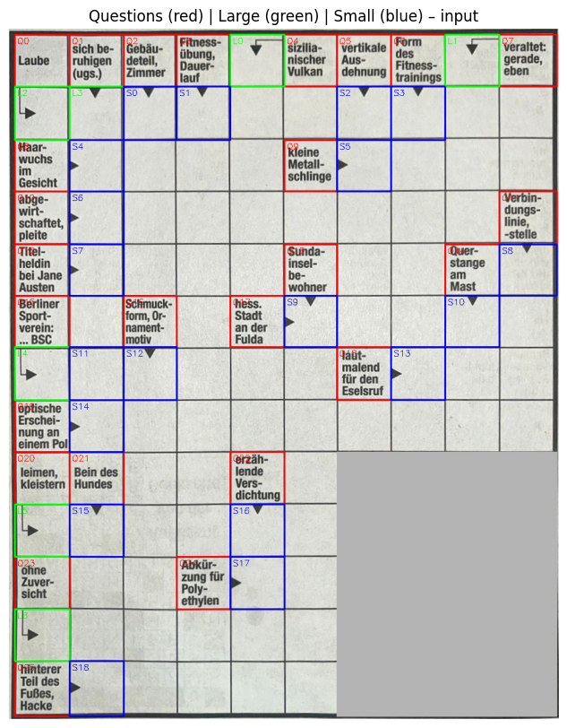
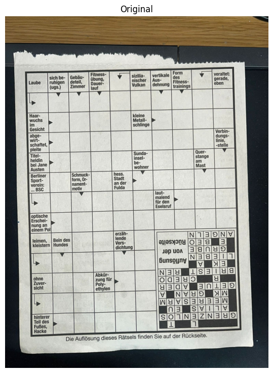
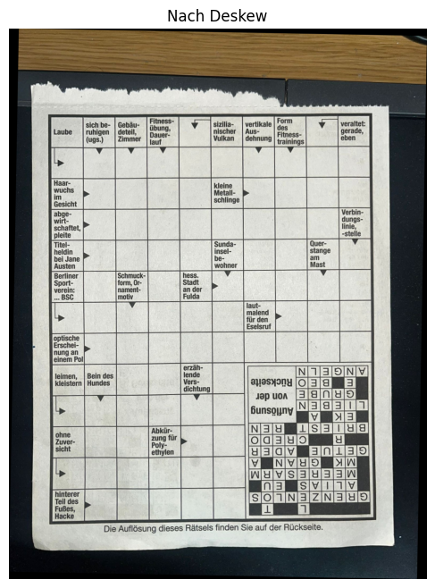
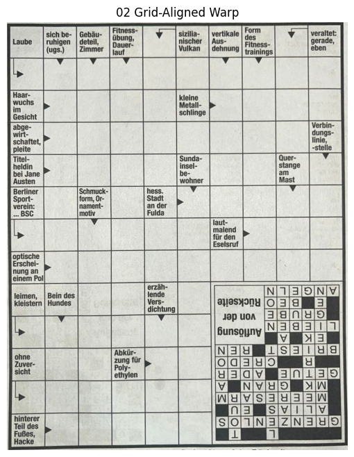
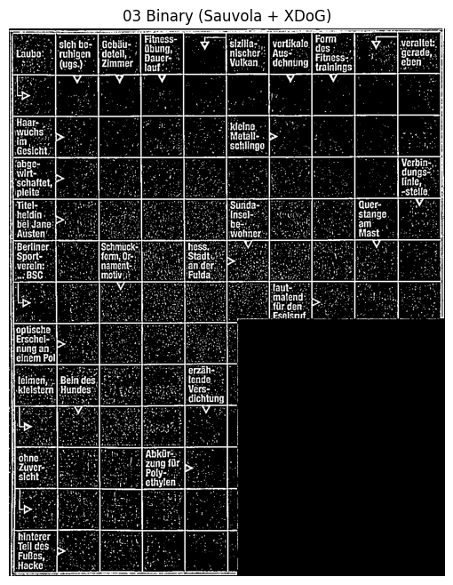
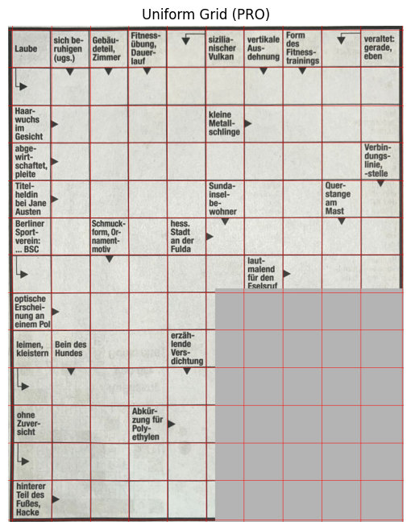
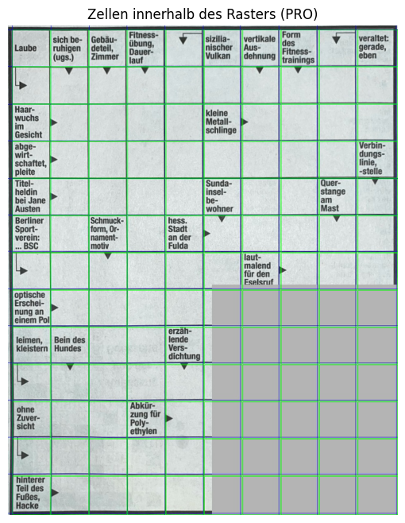
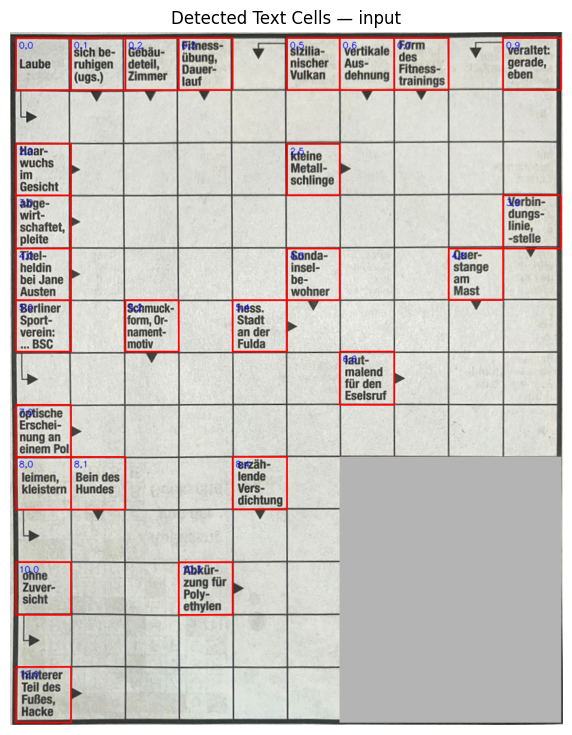
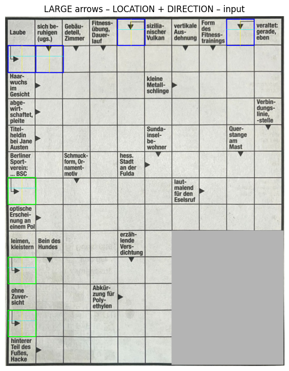
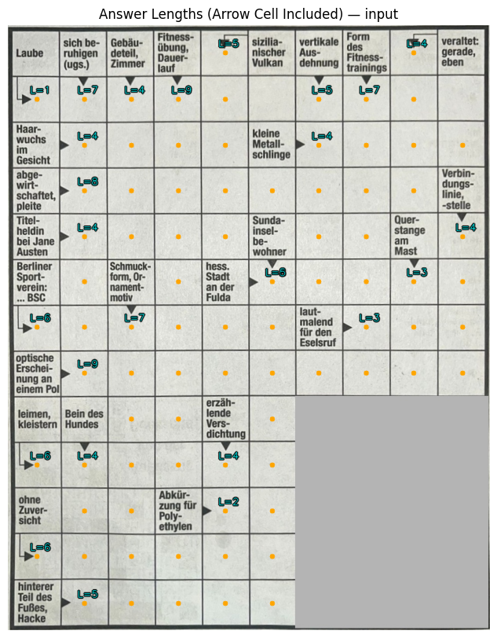

# End-to-End Crossword Solver

An automated system that takes a photograph of a German crossword puzzle and produces a solved grid — no manual
intervention after the image is uploaded.

The project chains computer vision, OCR, web scraping, large language models and constraint-satisfaction
solving into a single pipeline that runs in a Jupyter notebook.



---

## Contents

- [How it works](#how-it-works)
- [Pipeline stages](#pipeline-stages)
- [Solving strategy](#solving-strategy)
- [Technologies](#technologies)
- [Repository structure](#repository-structure)
- [Setup](#setup)
- [Usage](#usage)
- [Limitations and future work](#limitations-and-future-work)
- [License](#license)

---

## How it works

The solver treats the problem as a sequence of well-defined stages.  Each stage reads the output of the
previous one, so the notebook cells can be executed top to bottom without branching.

1. **Image → clean grid.**  The raw photograph is deskewed, perspective-corrected and binarised to recover
   straight grid lines.
2. **Grid → cells.**  Rows and columns are detected and each cell is extracted individually.
3. **Cells → structure.**  Every cell is classified as *empty*, *question* (contains a clue) or *arrow*
   (indicates answer direction).  Arrows are linked to their corresponding questions, and the answer length
   is computed by walking the grid until a boundary or another question is reached.
4. **Structure → clues.**  Question cells are sent to OpenAI Vision for OCR, producing German-language clue
   text.
5. **Clues → answers.**  Candidates are harvested from a crossword dictionary (wort-suchen.de) and an LLM.
   Shared letters at intersections are propagated, and a CSP back-tracker fills the remaining gaps.

---

## Pipeline stages

### Stage 0 — Input and resize

The uploaded image is resized to a working resolution.



### Stage 1 — Deskew

Automatic rotation correction aligns the grid horizontally.



### Stage 2 — Grid warp and rectification

Perspective correction straightens the grid into a rectangle, followed by masked-grid extraction.



### Stage 3 — Binarisation and grid-line extraction

Strong binarisation (CamScanner-style) recovers clean horizontal and vertical grid lines.



### Stage 4 — Uniform grid construction

Detected lines are regularised into a perfect uniform grid, correcting local distortions.



### Stage 5 — Cell extraction

Every cell is cut out individually.  The expected grid size (13 × 10) is enforced.



### Stage 6 — Question-cell detection

Cells that contain printed clue text are identified via ink-density and component-shape analysis.  A
centre-box recovery pass (Stage 6.1) rescues difficult cases.



### Stage 7 — Arrow detection and direction

Large and small arrow heads are detected with template matching.  Each arrow's direction (→ or ↓) determines
where the answer starts and which way it runs.



### Stages 8–10 — Linking, length and merged QA

Arrows are associated with the nearest question, the answer length is computed by grid traversal, and
everything is merged into a single structured CSV.



---

## Solving strategy

Once the structural analysis is complete, the solver works in three steps:

1. **Candidate harvesting.**  For each clue, candidate words of the correct length are fetched from
   [wort-suchen.de](https://www.wort-suchen.de) (a German crossword dictionary) and from an LLM.  If both
   sources return nothing, the LLM is prompted again with relaxed constraints so that no clue ends with zero
   candidates.

2. **Letter propagation.**  Answers that have only one candidate are fixed, and their letters are propagated
   to every intersecting answer.  This loop repeats until no further deductions can be made.

3. **CSP backtracking.**  The remaining unfilled answers are modelled as a constraint-satisfaction problem
   (clues = variables, candidate lists = domains, shared cells = constraints) and solved with backtracking
   search over the "warm" grid.

---

## Technologies

| Category | Tools |
|---|---|
| Language | Python 3.10 |
| Computer vision | OpenCV, imutils, NumPy |
| Data processing | Pandas, NumPy |
| Visualisation | Matplotlib |
| OCR | OpenAI Vision API |
| Web scraping | Requests, BeautifulSoup |
| LLM reasoning | OpenAI GPT API |
| Interactive upload | ipywidgets |
| Environment | Google Colab (recommended) / Jupyter Notebook |

---

## Repository structure

```
.
├── notebooks/
│   └── End_to_End_Crossword_Solver.ipynb   # complete pipeline
├── figures/                                 # pipeline stage visualisations
├── docs/
│   └── presentation.pptx                   # project presentation (25 slides)
├── requirements.txt
├── .gitignore
├── LICENSE
└── README.md
```

---

## Setup

### Google Colab (recommended)

1. Upload `notebooks/End_to_End_Crossword_Solver.ipynb` to [Google Colab](https://colab.research.google.com).
2. Run the first cell to install dependencies.
3. Set your OpenAI API key:
   ```python
   import os
   os.environ["OPENAI_API_KEY"] = "your-key-here"
   ```

### Local

```bash
git clone https://github.com/<your-username>/crossword-solver.git
cd crossword-solver

python -m venv .venv
source .venv/bin/activate        # Windows: .venv\Scripts\activate

pip install -r requirements.txt
```

Then open the notebook with `jupyter notebook notebooks/End_to_End_Crossword_Solver.ipynb` and set the
API key as shown above.

---

## Usage

1. Run the notebook cells in order.
2. When prompted, upload a crossword puzzle image (a clear scan or photograph of a German crossword).
3. The pipeline processes the image automatically through all stages.
4. The final output is a solved grid stored as a CSV in `results_grid/`.

---

## Limitations and future work

**Current limitations:**

- Requires a reasonably clear, printed crossword (hand-drawn grids are not supported).
- Tuned for a 13 × 10 grid layout; other sizes need parameter adjustment.
- OCR and candidate generation depend on the OpenAI API (requires an API key and incurs cost).
- German-language crosswords only.

**Possible extensions:**

- Multi-language support (English, French, etc.).
- A custom-trained OCR model to remove the API dependency.
- Support for non-standard grid sizes and shapes.
- Real-time optimisation and a web-based interface.

---

## License

[MIT](LICENSE)
