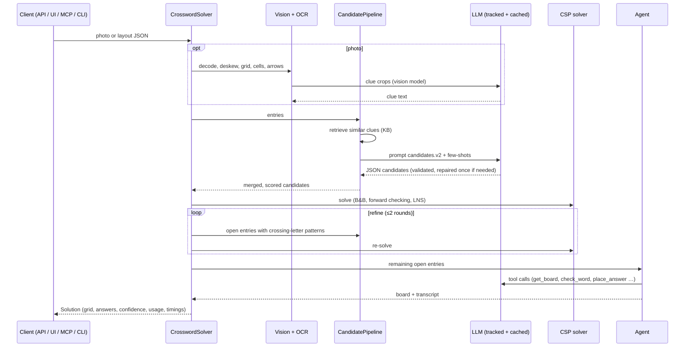

# Architecture

## Request flow



## Layers

| Layer | Responsibility | Key types |
|---|---|---|
| `models.py` | Domain objects shared by every layer and serialised by the API | `PuzzleLayout`, `Entry`, `Candidate`, `Solution` |
| `vision/` | Pure `ndarray → ndarray` stages ported from the notebook; no I/O | `GridGeometry`, `VisionResult` |
| `llm/` | One `LLMClient` protocol; adapters for OpenAI, Anthropic and fakes; middleware for cache, cost and budget | `LLMClient`, `TrackedLLM`, `CachedLLM`, `UsageTracker` |
| `knowledge/` | Clue store and retrievers | `ClueStore`, `TfidfRetriever`, `EmbeddingRetriever`, `HybridRetriever` |
| `candidates/` | Independent sources behind one protocol, fused with noisy-OR | `CandidateGenerator`, `CandidatePipeline` |
| `solver/` | Deterministic search plus the LLM agent | `solve`, `Board`, `SolverAgent` |
| `pipeline.py` | Orchestration, timings, budget handling | `CrosswordSolver`, `SolveReport` |
| `serving/` | Interfaces only — no business logic | FastAPI app, MCP server, Streamlit UI |

All interfaces call the same `CrosswordSolver`, so a fix in one place reaches the API, the UI, the MCP tools and the
evaluation at once.

## Candidate scoring

Each source returns candidates with a confidence in [0, 1]. The merge treats sources as independent evidence:

```
p(word) = 1 − Π_sources (1 − weight_source · confidence)
```

so a word proposed by the LLM *and* the dictionary outranks a word proposed by one of them with slightly higher
confidence. Knowledge-base hits only become direct candidates for near-duplicate clues (similarity ≥ 0.75), because
character n-gram similarity is a poor proxy for meaning ("Absicht" ≈ "Gesicht"). Weaker hits are still used — as
few-shot evidence inside the LLM prompt.

## Solver

* **Variables** are entries; **domains** are their candidates plus *NULL* (leave open).
* **Objective**: Σ candidate scores + 0.25 per crossing where both entries are filled.
* **Search**: depth-first branch & bound, MRV variable order, values ordered by score × crossing support, forward
  checking on crossing entries, admissible upper bound. A greedy pass provides the first incumbent.
* **Large-neighbourhood search** runs if the node budget is hit: free one entry and its crossings (two levels), solve
  that region exactly, keep improvements.

Why NULL matters: candidate lists from OCR'd clues are never complete. A strict CSP fails the whole grid because one
answer is missing; this one returns the best consistent partial grid and lets the refine loop and the agent fill the
gaps with the crossing letters it has established.

## Agent

The agent receives a short system prompt (`agent.v1`) and tools; it reads the board through `get_board` instead of a
large prompt, so context stays small and the board is always current. Safety properties:

* every write goes through `place_answer`, which normalises the word and rejects clashes with letters on the board;
* bad tool arguments return an error message to the model instead of raising;
* hard step limit (`CWS_AGENT_MAX_STEPS`) and the per-puzzle cost budget stop runaway loops;
* the full transcript is returned for debugging and shown in the UI.

## Configuration

All settings are environment variables with the `CWS_` prefix (see `config.py` and `.env.example`). Nothing
behaviour-relevant is hard-coded in the pipeline: grid size, solution-box mask, models, retriever type, budgets and
feature flags (web dictionary, agent) are configurable per deployment.
